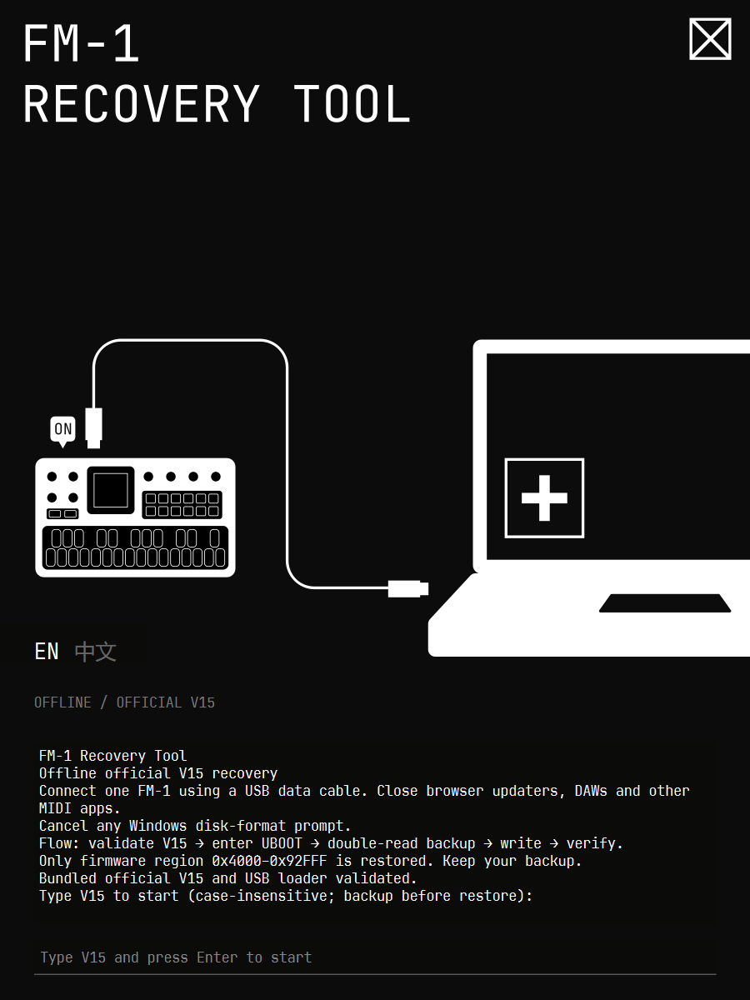

<p align="left">
  
</p>

# FM-1 Recovery Tool

FM-1 Windows x64 本地离线恢复官方 V15。非官方工具，与 M-VAVE 无隶属关系。

FM-1 Offline official V15 recovery for Windows x64. Unofficial; not affiliated with M-VAVE.

## 使用 / Usage

1. 将 `FM-1 Recovery Tool.exe` 放在可写文件夹，只连接一台 FM-1，使用 USB 数据线直连。关闭网页升级工具、DAW 和其他 MIDI 程序。

   Put the EXE in a writable folder. Connect one FM-1 directly with a USB data cable. Close browser updaters, DAWs and other MIDI apps.

2. 双击 EXE，允许管理员权限；直接进入 GUI，点击 EN 或中文即可切换，不再显示语言选择菜单。Windows 提示格式化磁盘时，选择取消。

   Double-click the EXE and allow administrator access. The GUI opens directly; click EN or 中文 to switch without a language-selection menu. Cancel any Windows disk-format prompt.

3. 等待终端显示校验通过，在最底部输入栏输入 `V15` 或 `v15`，回车。程序先备份，再恢复。写入期间不要断电、拔线或关闭窗口。

   Wait for validation in the terminal, then type `V15` or `v15` in the bottom input field and press Enter. A backup is required before restoring. Do not power off, unplug or close the window during writing.

4. 显示验证成功后，拔 USB、关机、等待 5 秒，再开机。

   After verification succeeds, unplug USB, power off, wait five seconds, then power on.

## 自动流程 / Automatic workflow

校验内置 V15 → 检测 UBOOT（必要时直接发送 MIDI SysEx `F0 22 24 35 7D F7`）→ 核对 WL82 → 等待 5 秒 → 上传 RAM loader → 等待 1 秒 → 核对芯片 key `0x980F` 和 Flash ID `0x856014` → 两次完整读取 1 MiB、比较并保存备份 → 只恢复 `0x4000–0x92FFF` → 逐字节回读验证。

Validate bundled V15 → detect UBOOT (send MIDI SysEx `F0 22 24 35 7D F7` if needed) → confirm WL82 → wait five seconds → upload RAM loader → wait one second → check chip key `0x980F` and flash ID `0x856014` → read the full 1 MiB twice, compare and save → restore only `0x4000–0x92FFF` → verify every byte.

启动阶段发生 USB 传输错误：关闭旧连接，等待 10 秒，重新扫描并重试一次。固件已经相同则备份后跳过重复写入。回读不一致时后端最多重写一次。不会因启动成功而额外刷写第二遍。

On a startup USB transport error, close the connection, wait ten seconds, rescan and retry once. If firmware already matches, skip writing after backup. A read-back mismatch allows one rewrite. Successful startup does not trigger an extra flash cycle.

## 备份及故障 / Backups and failures

完整备份位于 EXE 旁 `backups`，日志在 `logs`。请保留；备份包含设备上的歌曲和音色。文件名含 `dryrun` 的备份仅为模拟。

Full backups are in `backups` beside the EXE; logs are in `logs`. Keep them. Backups include on-device songs and sounds. Files marked `dryrun` are simulated.

启动或备份阶段失败时，本次尚未擦写固件，可检查线缆、直连端口后重试。写入或验证阶段失败时，不要断电或拔线，保留备份和日志并再次运行恢复。

If startup or backup fails, no firmware erase/write has started in that run; check the cable/direct USB port and retry. If writing or verification fails, do not power off or unplug; keep backups and logs and rerun recovery.

恢复只改固件，不清空设置。若 V15 音色异常，可在设备上尝试 `System > Reset Patches`。若既无 MIDI 响应也不出现 UBOOT，软件无法继续，可能需要 Transporter 硬件恢复。

Recovery changes firmware, not settings. If V15 patches behave incorrectly, try `System > Reset Patches` on the device. If neither MIDI nor UBOOT is available, software cannot proceed; Transporter hardware recovery may be needed.

## 离线与自测 / Offline operation and self-test

EXE 内置 Python、MIDI/USB 库、loader 和 V15，无需另装 Python、pip 或 Git。运行流程不下载文件，Python 网络连接及解析已禁用；使用 Windows 自带 PowerShell 和 USB 驱动。控制台使用所选语言，完整技术诊断保存在日志文件中。

The EXE bundles Python, MIDI/USB libraries, loader and V15. No Python, pip or Git installation is required. Recovery downloads nothing; Python network connections and DNS resolution are blocked. Windows PowerShell and built-in USB drivers are used. The console uses the selected language; full technical diagnostics are retained in log files.

在 PowerShell 中运行以下命令，仅模拟，不访问真实设备、不要求管理员权限：

Run in PowerShell to simulate without real hardware or administrator access:

```powershell
& '.\FM-1 Recovery Tool.exe' --demo
```

此前的自动重试版已由用户报告真机恢复成功。本次语言及名称修改已做模拟测试，未由开发代理执行真机刷写。Windows 11 x64 构建；其他系统版本未实测。

The user reported successful real-device recovery with the preceding startup-retry version. This naming/language revision was simulated; the development agent performed no real-device writes. Built on Windows 11 x64; other OS versions have not been tested.

## 源码构建 / Build from source

源码包包含内置固件和固定版本后端，不包含用户的设备备份、日志或虚拟环境。首次准备构建环境需要联网下载 Python 包；生成的 EXE 使用时离线。

The source package includes bundled firmware and pinned backends, but no user device backups, logs or virtual environment. Initial build preparation needs internet access for Python packages; the resulting EXE runs offline.

使用 Windows x64、Python 3.14（本次为 3.14.1）：

Use Windows x64 and Python 3.14 (this build used 3.14.1):

```powershell
python -m venv .venv
.\.venv\Scripts\python.exe -m pip install -r build-requirements.txt
.\.venv\Scripts\python.exe -m pip install -r gui-requirements.txt
.\.venv\Scripts\python.exe -m unittest test_boot_key test_read_failure -q
.\.venv\Scripts\python.exe verify_gui.py
.\.venv\Scripts\python.exe -m PyInstaller --noconfirm FM1-V15-Offline.spec
.\.venv\Scripts\python.exe -m PyInstaller --noconfirm --distpath gui-dist FM1-GUI.spec
& '.\gui-dist\FM-1 Recovery Tool.exe' --demo
```

若依赖没有匹配的二进制 wheel，可能需要 Microsoft C++ Build Tools。源码包的底层库版本标记 `.fm1-unbrick-commit` 必须保留。

If matching dependency wheels are unavailable, Microsoft C++ Build Tools may be required. Keep the backend `.fm1-unbrick-commit` version marker.

## 致谢与来源 / Credits and provenance

- 社区恢复教程 / Community recovery guide — u/acrawf1，及教程中致谢的 u/International-Soup24：
  https://www.reddit.com/r/MVaveFM1/s/lUaXiCsOk8
- 恢复后端 / Recovery backend — Quixotic7 and MvaveFM1Unbricker contributors, MIT:
  https://github.com/Quixotic7/MvaveFM1Unbricker
  Base commit: `707470a521d49c9791b373ff522653dd41dd6f4a`.
- 底层协议及 WL82 loader 来源 / Low-level protocol and WL82 loader source — kagaimiq, jl-uboot-tool:
  https://github.com/kagaimiq/jl-uboot-tool
  Commit: `adb3f18889e88ac512ce0a3c4d8cc3d3cb30696a`.
- 网页 bootloader 指令参考 / Browser boot-key reference — The Firmware Hub:
  https://thefirmwarehub.com/
- 官方 V15 固件来源 / Official V15 firmware source — M-VAVE:
  https://github.com/m-vave/fm1_open
  内置文件为用户提供的 `FM-1_015.fwsc`，未修改 / Bundled file: user-supplied `FM-1_015.fwsc`, unchanged.
  File SHA-256: `db1642b2b6fa5c2cccb11ffd13878068bb28601678d3644049f99dc40e7edb8a`.
  Firmware-region SHA-256: `6edf3c37fb5bbbc33607c89375ee024d5477c17914d72221c8c68e58a8255686`.

保留的上游许可证见 `licenses` 和 `upstream`。本项目代码许可证不替代固件或第三方二进制各自的授权。

GUI uses unmodified dynamically loaded PySide6 / Qt 6.12 libraries under LGPLv3; license texts are retained. Source for Qt and PySide6: https://code.qt.io/cgit/qt/ and https://code.qt.io/cgit/pyside/pyside-setup.git/ (6.12.0). This source package and build scripts allow rebuilding with replacement Qt libraries; reverse engineering for debugging modifications to those libraries is permitted under their license. SprayMindsMono is a modified JetBrains Mono font under SIL OFL 1.1; the supplied font README and OFL text are included. The vector artwork was supplied by the user; its rights remain with its owner.

Retained upstream licenses are in `licenses` and `upstream`. The project code license does not replace the permissions applicable to firmware or third-party binaries.

本地修改 / Local changes: output-only boot key without identity handshake; offline network guard; bilingual operator prompts; case-insensitive V15 confirmation; startup settling delays and one transport retry; contextual read-error logging; PyInstaller single-file packaging.
